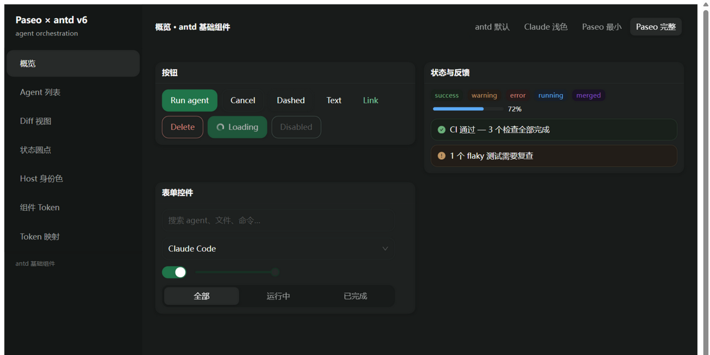
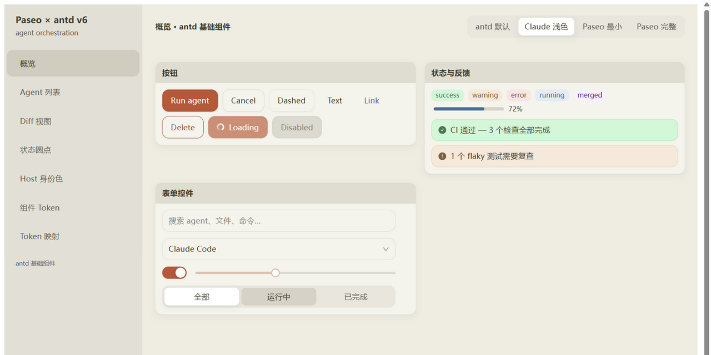

# paseo-antd-themes

**Paseo Dark** 与 **Claude Light** 两套 **Ant Design v6** 主题。共享同一套 token 管线、字体度量和组件级行为，可作为 antd 默认主题的替代。

## 安装

```bash
npm install paseo-antd-themes
```

本包是 **ESM-only**（`"type": "module"`，只提供 `import` 入口）；不支持 CJS `require` 和 Node10 解析。Peer dependencies：

- `antd >= 6.6.0 < 7`
- `react >= 18`
- `react-dom >= 18`

## 使用

### PaseoThemeProvider（推荐）

`PaseoThemeProvider` 是 `ConfigProvider` 的替代品：按 `mode` 选择主题，并自动注入自定义 loading 图标、Segmented 间隙和 Select 行间透明间隔。不需要额外引入 CSS。

```tsx
import { PaseoThemeProvider } from "paseo-antd-themes";

<PaseoThemeProvider mode="system">
  <App />
</PaseoThemeProvider>;
```

- `mode`: `"system" | "dark" | "light"`，默认 `"system"`，跟随 `prefers-color-scheme`。
- `theme`: 传入任意 `ThemeConfig` 覆盖内置主题，优先级高于 `mode`。
- `ssrMode`: `"dark" | "light"`（默认 `"light"`）。`mode="system"` 时服务端无法感知客户端偏好，SSR 输出由它决定；如果你的服务端能从 cookie/请求头解析出主题偏好，在这里传入可以避免首帧闪白。
- `loadingIcon`: 替换默认 loading 图标；默认是本包的双弧渐变 spinner。
- 其余 `ConfigProvider` props（`locale`、`direction`、`componentSize` 等）原样透传。

> **虚拟滚动 Select**：下拉列表超过一屏（默认约 256px）时 rc-virtual-list 开始接管渲染。此时必须同时传 `<Select listItemHeight={44}>`，否则虚拟列表仍按 antd 默认 40px 估算行高，行间透明间隔会错位；不开启虚拟滚动的 Select（如 `virtual={false}` 或短列表）不需要。

### 裸主题配置

只需要 token 时，继续用 antd 的 `ConfigProvider`：

```tsx
import { ConfigProvider } from "antd";
import { claudeLightTheme } from "paseo-antd-themes/claude";

<ConfigProvider theme={claudeLightTheme}>
  <App />
</ConfigProvider>;
```

```tsx
import { paseoDarkTheme } from "paseo-antd-themes/paseo";
```

> 裸主题只包含 token；自定义 loading 图标、Segmented / Select 间隙只在 `PaseoThemeProvider` 中生效。

## Exports

| 入口 | 导出 |
| --- | --- |
| `paseo-antd-themes` | `PaseoThemeProvider`, `ClaudeLoadingIcon`, `claudeLightTheme`, `paseoDarkTheme`, types |
| `paseo-antd-themes/claude` | `claudeLightTheme`, `claudeLight`, `claudeIdentityLight`, token mappings |
| `paseo-antd-themes/paseo` | `paseoDarkTheme`, `paseoDark`, token mappings |

## 两套主题

| Paseo Dark · 概览 | Claude Light · 概览 |
| --- | --- |
|  |  |

| 维度 | Paseo Dark（完整） | Claude Light |
| --- | --- | --- |
| 定位 | 长时间运行的 agent orchestration 深色工作台 | 日间、评审/文档式的 Claude 品牌浅色界面 |
| 表面 | 青绿调深色阶梯，层与层靠亮度区分 | 官网取色奶油底 `#F0EDE2` + 纸感卡片 `#F5F4EC`，暖黑文字 |
| 主色 | paseo 深绿；链接用更亮的绿 | Claude 官网 clay；链接用 suggestion 蓝 |
| 状态色 | paseo 归一化家族，为深色表面调校 | 同一等响度规则在浅色表面重解 |
| Diff | 降饱和深色行底，白字可读 | 低饱和浅色行底 + 深色统计文字 |
| 阴影 | 黑色系软阴影 | 暖墨色软阴影 |
| 适合 | 夜间、专注、终端/agent 工作流 | 白天、评审/文档、Claude 品牌场景 |

**Paseo Dark** 保留 paseo 的青绿深色表面和绿色身份，状态色按等响度规则归一化。完整方案把控件形态和软阴影同步到了与浅色一致的语言，因此它不再是 paseo 原始紧凑扁平形态的 1:1 移植。

**Claude Light** 从 claude.ai 官网截图像素取色重推：奶油页面 `#F0EDE2`、只亮 1.06 的纸感卡片 `#F5F4EC`、hover `#DDD9CE`、暖黑文字 `#3C3C2C`，主色用官网交互态 clay `#BA5B37`（白字 4.53:1）。状态色仍按 paseo 等响度规则在浅色表面重解。完整取值见 [DESIGN.md](./DESIGN.md)。

> 仓库里的 `src/paseo/` 是最小方案（13 个 token），不包含在 npm 包内，只作为开发对照保留。

## 开发与验证

```bash
npm install
npm run typecheck
npm test
npm run build:lib      # 发布产物：ESM + d.ts（相对导入自动补 .js）
npm run build:demo     # demo，输出到 dist-demo/
npm run verify:package # 打包并校验：exports、CJS 残留、声明解析、publint、attw (esm-only)
npm run pack:dry       # npm pack --dry-run（触发 prepack 构建）
```

`npm publish` 流程：`prepublishOnly`（typecheck + test）→ `prepack`（build:lib + verify:package）→ 发布。发布前需要先 `npm login`。

设计取值、状态色归一化规则和算法包装细节见 [DESIGN.md](./DESIGN.md)；完整 token 映射见 [MAPPING.md](./MAPPING.md)。

## License

MIT
