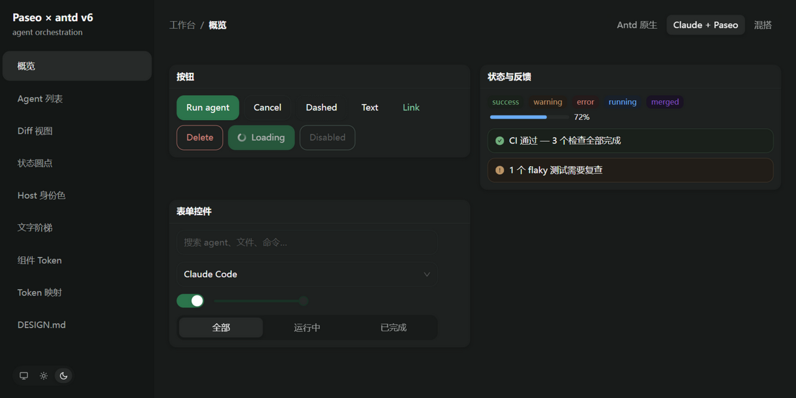
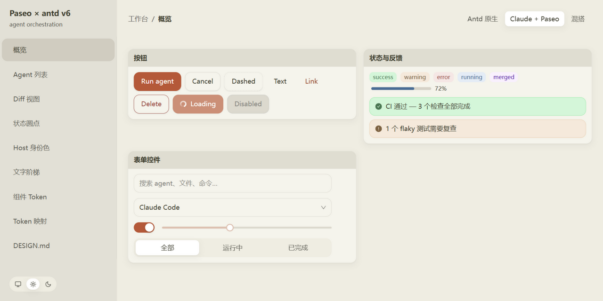

# paseo-antd-theme

**Paseo Dark** 与 **Claude Light** 两套完整的 Ant Design v6 主题，加上 **antd 原生亮/暗**，填进一个亮色槽位和一个暗色槽位自由搭配。同一套 token 管线同时导出为 Tailwind v4 / v3 可用的样式表。

[](https://www.npmjs.com/package/paseo-antd-themes)
[](https://github.com/BanShan-Alec/paseo-antd-theme/blob/master/packages/theme/LICENSE)
[](https://banshan-alec.github.io/paseo-antd-theme/)

**在线 Demo → [banshan-alec.github.io/paseo-antd-theme](https://banshan-alec.github.io/paseo-antd-theme/)**

顶部切换器选配对（Antd 原生 / Claude + Paseo / 混搭），侧边栏底部用图标切换亮色 / 暗色 / 跟随系统（默认跟随系统）。demo 由 GitHub Actions 在 `master` 更新时自动部署到 Pages。

| Paseo Dark · 概览 | Claude Light · 概览 |
| --- | --- |
|  |  |

## 安装

```bash
npm install paseo-antd-themes
```

本包是 **ESM-only**（只提供 `import` 入口）；不支持 CJS `require` 和 Node10 解析。Peer dependencies：`antd >= 6.6.0 < 7`、`react >= 18`、`react-dom >= 18`。

## 最小示例

```tsx
import { PaseoThemeProvider } from "paseo-antd-themes";

export function Root() {
  return (
    <PaseoThemeProvider mode="system">
      {/* 亮色 = Claude Light，暗色 = Paseo Dark */}
      <App />
    </PaseoThemeProvider>
  );
}
```

`PaseoThemeProvider` 是 `ConfigProvider` 的替代品：按 `mode` 从亮/暗两个槽位选一套主题、按需安装组件级行为（加载图标、Segmented / Select 间隙），其余 props 原样透传。混搭槽位、`extendTheme` 改品牌色、裸 `ConfigProvider`、Tailwind v4 / v3、不用 Tailwind 直接读 `var(--paseo-*)` —— 这些用法都在 [包的完整 README](packages/theme/README.md)。

## 仓库结构

| 路径 | 内容 |
| --- | --- |
| `packages/theme` | 发布到 npm 的 `paseo-antd-themes` 包：四套主题、`PaseoThemeProvider`、Tailwind 导出、`DESIGN.md` / `MAPPING.md` / `preview.html` |
| `packages/demo` | 消费**构建产物**的 Vite demo，即线上 demo 的源码 |
| `docs/` | 博客与配色材料 —— 仓库级内容，不随包发布 |
| `scripts/` | 仓库级门禁（`verify:demo`） |

## 开发

```bash
pnpm install
pnpm dev              # 先构建主题包，再启动 demo（http://localhost:5173）
pnpm build            # 主题包 + demo（拓扑序）
pnpm typecheck
pnpm test
pnpm verify:package   # npm pack + publint + attw
pnpm verify:demo      # 防 demo 绕过包入口
pnpm gen:tailwind     # 重生成 theme.css / vars.css / preset.cjs
pnpm gen:mapping      # 重生成 MAPPING.md
pnpm gen:preview      # 重生成 preview.html
```

demo 只通过已发布入口消费 `paseo-antd-themes`（主题、Provider、token 映射表、`DESIGN.md`、Tailwind preset），所以主题包必须先构建；根脚本已经处理好顺序。两道门禁保证这件事不被绕过：

- `pnpm verify:package` —— 对发布 tarball 跑 `npm pack` + publint + attw。
- `pnpm verify:demo` —— demo 一旦回退成相对导入、出现 hex/rgb 字面量或内联尺寸值就失败；工具类必须解析到 `var(--paseo-*)`，六个配对 × 明暗作用域由包的 `generateTailwindVariables` 生成。

## 延伸阅读

| 文档 | 内容 |
| --- | --- |
| [packages/theme/README.md](packages/theme/README.md) | 包的完整用法：九条消费路径、Provider 行为、主题扩展、0.1.0 迁移 |
| [DESIGN.md](packages/theme/DESIGN.md) | 每个 token 该怎么用（具体取值不在这里） |
| [MAPPING.md](packages/theme/MAPPING.md) | 逐 token 取值与取色来源 |
| [preview.html](packages/theme/preview.html) | 一页式规格页：色板、字阶、间距、阴影与实测对比度，下载后直接打开 |
| [antd v6 + Tailwind v4 组合最佳实践](docs/antd-v6-tailwind-v4.md) | `@layer` 顺序、`StyleProvider layer`、暗色与 SSR |
| [从 antd v4 + Tailwind v3 到 antd v6 + Tailwind v4（上）](docs/antd-v6-tailwind-v4-part1-concepts-and-overrides.md) | 面向 v3 / antd v4 开发者的概念补课与覆盖写法 |
| [antd v6 + Tailwind v3 最佳实践](docs/antd-v6-tailwind-v3-best-practices.md) | 不开 layer 时，用构建期 token 同步两边 |

## License

MIT，见 [packages/theme/LICENSE](packages/theme/LICENSE)。
