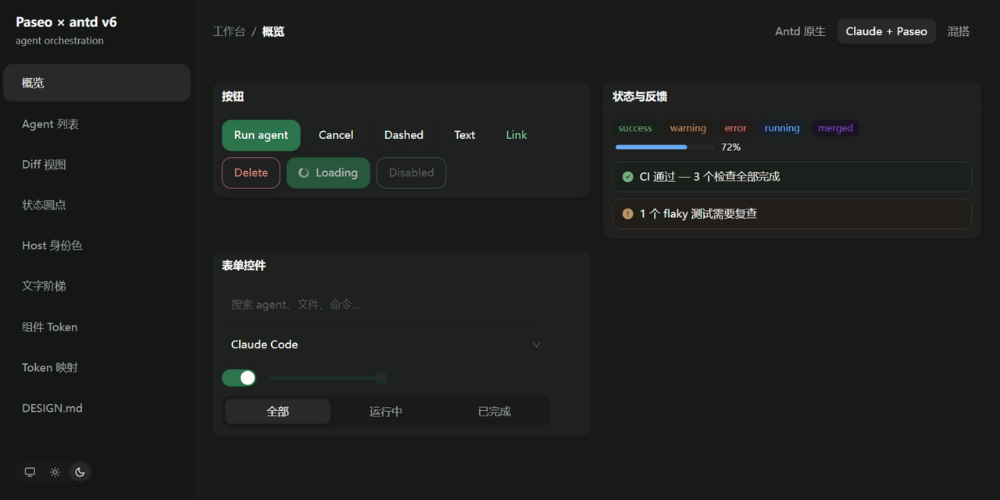
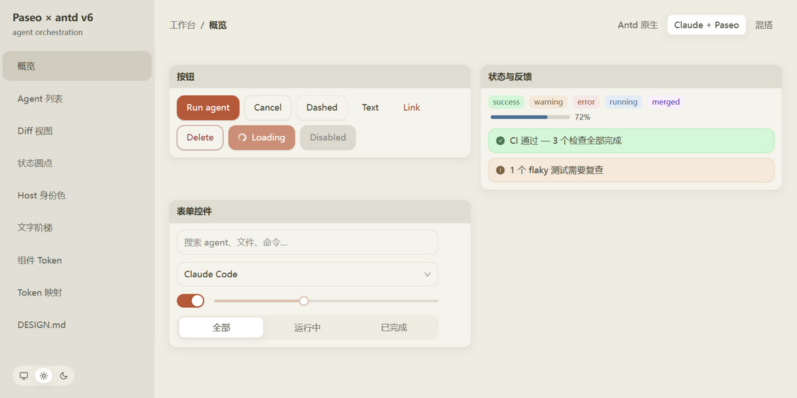

# paseo-antd-themes

**Paseo Dark**、**Claude Light** 两套完整主题，加上 **antd 原生亮/暗**，填进一个亮色槽位和一个暗色槽位，自由搭配（例如 antd 原生亮 + Paseo 暗）。共享同一套 token 管线、字体度量和组件级行为。

> **快速预览**：在线 demo 部署在 GitHub Pages —— [https://banshan-alec.github.io/paseo-antd-theme/](https://banshan-alec.github.io/paseo-antd-theme/)，顶部切换器选配对（Antd 原生 / Claude + Paseo / 混搭），侧边栏底部用图标切换亮色 / 暗色 / 跟随系统（默认跟随系统）。不想开 demo 时，安装后直接打开包内的 `preview.html`，一页看完两套配色的色板、字阶、间距、阴影与实测对比度。

## 安装

```bash
npm install paseo-antd-themes
```

本包是 **ESM-only**（`"type": "module"`，只提供 `import` 入口）；不支持 CJS `require` 和 Node10 解析。Peer dependencies：

- `antd >= 6.6.0 < 7`
- `react >= 18`
- `react-dom >= 18`

## 使用

### 先选入口

| 你的场景 | 用什么 | 看哪节 |
| --- | --- | --- |
| React + antd，要完整形态与组件行为 | `PaseoThemeProvider` | 下文「PaseoThemeProvider（推荐）」 |
| 只用主题、不想换 Provider | 裸 `ThemeConfig` + antd 的 `ConfigProvider` | 下文「裸主题配置」 |
| 换品牌色 / 改单个 token | `extendTheme` | 下文「从一个内置主题扩展」 |
| 只要那个 spinner | `PaseoLoadingIcon` | 下文「单独使用 PaseoLoadingIcon」 |
| Tailwind v4，不装 antd | `paseo-antd-themes/tailwind.css` | 下文「Tailwind v4」 |
| Tailwind v3 | `tailwind-vars.css` + `tailwind-preset` | 下文「Tailwind v3」 |
| antd 与 Tailwind 混用 | 上一层 `StyleProvider layer` | 下文「Tailwind v4 + antd v6」 |
| 不用 Tailwind（Vue / 纯 CSS / CSS-in-JS） | `var(--paseo-*)` | 下文「不用 Tailwind」 |
| 同一页切换多套配对 | `generateTailwindVariables` | 下文「Tailwind v3」里的「多主题」 |

### PaseoThemeProvider（推荐）

`PaseoThemeProvider` 是 `ConfigProvider` 的替代品：它只做三件事——按 `mode` 从亮/暗两个槽位里选一套主题、按需安装组件级行为、其余 props 透传给 antd。槽位里放什么由你决定，可以整对替换，也可以只换一侧。

```tsx
import { PaseoThemeProvider } from "paseo-antd-themes";

// 默认：亮 = Claude Light，暗 = Paseo Dark
<PaseoThemeProvider mode="system">
  <App />
</PaseoThemeProvider>;
```

混搭（antd 原生亮色 + Paseo 暗色，两套形态一致，切换不跳尺寸）：

```tsx
import { PaseoThemeProvider, antdLightTheme } from "paseo-antd-themes";

<PaseoThemeProvider mode="system" themes={{ light: antdLightTheme }}>
  <App />
</PaseoThemeProvider>;
```

- `themes`: `{ light?: ThemeConfig; dark?: ThemeConfig }`。**省略的槽位回落到内置默认**（Claude Light / Paseo Dark），所以只想换一侧时只传另一边即可。
- `mode`: `"system" | "light" | "dark"`，默认 `"system"`，跟随 `prefers-color-scheme`。
- `ssrMode`: `"dark" | "light"`（默认 `"light"`）。`mode="system"` 时服务端无法感知客户端偏好，SSR 输出由它决定；如果你的服务端能从 cookie/请求头解析出主题偏好，在这里传入可以避免首帧闪白。
- `behaviors`: 组件级行为，逐项默认开启、可单独关闭：
  - `loadingIcon`: `ReactElement | false`，默认本包的双弧渐变 spinner；`false` 用回 antd 自带图标。
  - `segmentedGap`: 默认 `true`，Segmented 项间 4px 间隙。
  - `selectGap`: 默认 `true`，Select 行间透明 2px 间隔。

  关掉的项连对应 CSS 都不会注入。
- 其余 `ConfigProvider` props（`locale`、`direction`、`componentSize` 等）原样透传。

行为与主题解耦：槽位里放 antd 原生主题时行为默认仍然生效；要还原 antd 原始形态就显式关掉：

```tsx
<PaseoThemeProvider
  mode="system"
  themes={{ light: antdLightTheme, dark: antdDarkTheme }}
  behaviors={{ loadingIcon: false, segmentedGap: false, selectGap: false }}
>
  <App />
</PaseoThemeProvider>;
```

> **虚拟滚动 Select**：下拉列表超过一屏（默认约 256px）时 rc-virtual-list 开始接管渲染。此时必须同时传 `<Select listItemHeight={44}>`，否则虚拟列表仍按 antd 默认 40px 估算行高，行间透明间隔会错位；不开启虚拟滚动的 Select（如 `virtual={false}` 或短列表）不需要。

### 单独使用 PaseoLoadingIcon

`PaseoLoadingIcon` 从主入口单独导出，不依赖主题，也不依赖 Provider。首次挂载时它自己把旋转关键帧注入 `<head>`（仅客户端、只注一次），所以在 provider 外使用照样会转；在 provider 内则复用 provider 的那份 `<style>`，不会多出一份。服务端不输出额外 `<style>`，水合没有差异。

```tsx
import { PaseoLoadingIcon } from "paseo-antd-themes";

// 自己的标记里：尺寸跟随 font-size（1em）
<span className="flex items-center gap-2">
  <PaseoLoadingIcon style={{ fontSize: 16 }} />
  正在读取工作区
</span>;

// Spin 的 indicator
<Spin indicator={<PaseoLoadingIcon />} />;

// Select 的 loadingIcon
<Select loading loadingIcon={<PaseoLoadingIcon />} options={options} />;

// 静态 message / notification
message.loading({ content: "部署中", icon: <PaseoLoadingIcon />, duration: 0 });
```

- 颜色走 `currentColor`，主按钮、文字按钮、深色表面上都自动跟随当前文字色。
- 旋转作用在内部 `<g>` 上，外层 1em 盒子不动，小尺寸下不会抖。
- 尺寸由 `font-size` 决定（`1em`），用 `style={{ fontSize: 16 }}` 或外层字号控制即可。
- Button 没有单组件级的 `loadingIcon` prop（antd 只在 `ConfigProvider` 上有 `button.loadingIcon`），要换按钮图标就走 Provider 的 `behaviors.loadingIcon`。反过来，把该行为关掉后在页面里手动放这个图标，它仍会自己注入关键帧。

### 从一个内置主题扩展

`extendTheme(base, { token, components })` 返回继承 `base` 的新主题，不改动 `base`。为什么需要它：内置主题在 algorithm 里钉死了调色板，antd 又会把 seed token 从 `theme.token` 覆盖层里删掉，所以直接嵌套 `ConfigProvider theme={{ token: { colorPrimary } }}` **不会生效**。`extendTheme` 把覆盖值放进派生链的最后一步，并重建整个色族，hover/active/bg/border/text 十槽跟着走。

```tsx
import { extendTheme, paseoDarkTheme, PaseoThemeProvider } from "paseo-antd-themes";

const violetPaseo = extendTheme(paseoDarkTheme, {
  token: { colorPrimary: "#7C6BF0" },
  components: { Button: { primaryColor: "#FFFFFF" } },
});

<PaseoThemeProvider mode="system" themes={{ dark: violetPaseo }}>
  <App />
</PaseoThemeProvider>;
```

- 覆盖 `colorPrimary` / `colorSuccess` / `colorWarning` / `colorError` / `colorInfo` 时，按方案重建该族十槽：深色走 antd 的 dark ramp，浅色走 OKLCH 归一化阶梯（浅色阶与本包浅色主题同一套规则，不沿用 antd 自带 ramp）。
- 其余 token（含 seed）与 `components` 照常合并；`components` 按组件浅合并，没提到的组件 token 保留。
- 主题深浅由 `base` 的 `colorBgBase` 亮度自动判断。

### 裸主题配置

只需要 token 时，继续用 antd 的 `ConfigProvider`：

```tsx
import { ConfigProvider } from "antd";
import { claudeLightTheme } from "paseo-antd-themes";

<ConfigProvider theme={claudeLightTheme}>
  <App />
</ConfigProvider>;
```

```tsx
import { antdDarkTheme, antdLightTheme, paseoDarkTheme } from "paseo-antd-themes";
```

> `antdLightTheme` / `antdDarkTheme` 是 antd 原生**配色** + 本包形态：颜色、填充、边框、阴影全部由 antd 算法派生，控件高度、圆角、Select 行高与字体栈则与内置主题一致，所以混搭槽位切换不会跳尺寸。唯一一处配色偏离：antd 把 Layout 的 `headerBg` 硬编码为深蓝 `#001529`（两种配色都是），这里改为透明让 body 背景透出，与内置主题「Header 与 body 同色」的规则一致。需要连尺寸也逐像素等于 antd 时，直接传 `{ algorithm: antdTheme.defaultAlgorithm }` / `{ algorithm: antdTheme.darkAlgorithm }`。
>
> 裸主题只包含 token；Segmented / Select 间隙只在 `PaseoThemeProvider` 中生效（`PaseoLoadingIcon` 本身可单独使用，见上文）。

### Tailwind v4（纯 CSS，无需 antd）

同一条 token 管线也发布为 Tailwind v4 样式表。值在构建期经 antd 管线解析（包含算法派生的 hover/active/色阶），发布为静态 CSS——**使用它的项目不需要安装 antd**：

```css
@import "tailwindcss";
@import "paseo-antd-themes/tailwind.css";
```

之后 `bg-primary`、`text-primary-hover`、`bg-surface-1`、`bg-text-secondary`、`border-split`、`font-sans`、`rounded-md`、`text-body`、`shadow-overlay` 等工具类直接可用。完整变量清单见 [MAPPING.md](./MAPPING.md) 的「Tailwind 变量映射」一节。

一张卡片就能看清 token 的搭配关系——surface 配 border、文字走 text 阶梯、按钮用 primary。Claude Light 的按钮 hover 沿用 Ant Design 亮色算法，白字对比度低于 4.5:1；这是短暂 hover 态的有意例外，静止填充不要复用：

```tsx
<div className="rounded-md border border-border bg-bg-container p-4">
  <div className="flex items-center justify-between">
    <span className="text-body text-text-secondary">构建 #128</span>
    <span className="flex items-center gap-1.5 text-caption text-text-tertiary">
      <span className="size-1.5 rounded-full bg-status-dot-success" />
      通过
    </span>
  </div>
  <p className="mt-2 text-text">feat: 新增 diff 统计</p>
  <button className="mt-3 rounded-sm bg-primary px-3 py-1.5 text-body text-text-light-solid hover:bg-primary-hover">
    查看详情
  </button>
</div>
```

字阶和阴影也走同一套系统：字号类自带配对行高（`text-body` = 14px / 22px），阴影只有「抬起」和「浮层」两级：

```tsx
<h2 className="text-heading">Agent 运行记录</h2>   {/* 24px / 32px */}

<div className="rounded-lg bg-surface-2 p-4 shadow-overlay">
  浮层内容
</div>
```

`shadow-raised` 是 hoverable 卡片与默认按钮悬停时的那一层，`shadow-overlay` 给真正浮在页面上的层（Dropdown / Modal / Popover / Notification）；静止的区块不加阴影，靠表面色和边框分层。

### Tailwind v3（preset + 变量表）

v3 没有 `@theme`，同一批变量以「preset + CSS 变量」两份产物发布：

```js
// tailwind.config.js
const preset = require("paseo-antd-themes/tailwind-preset");

module.exports = {
  content: ["./src/**/*.{ts,tsx}"],
  presets: [preset],
  // antd 自带 reset；preflight 二选一
  corePlugins: { preflight: false },
};
```

```css
/* 入口 CSS */
@import "paseo-antd-themes/tailwind-vars.css";
@tailwind base;
@tailwind components;
@tailwind utilities;
```

preset 里每个 utility 的值都是 `var(--paseo-*)`，所以：

- 单主题：`tailwind-vars.css` 提供 `:root` / `.dark` 两套值，切明暗不需要重新构建。
- 多主题（同一页面在不同配对之间切换）：不要用 `tailwind-vars.css`，改用包根导出的 `generateTailwindVariables(theme)`，为每套主题各生成一份变量块并挂到不同选择器上。它只返回「变量名 → 值」，与 v3 / v4 无关；demo 就是用它在 6 个 `[data-pair][data-scheme]` 作用域之间切换。

多主题的生成脚本（构建期跑一次，产物当普通 CSS 引入）：

```ts
// scripts/theme-scopes.ts
import { writeFileSync } from "node:fs";
import {
  antdDarkTheme,
  antdLightTheme,
  claudeLightTheme,
  generateTailwindVariables,
  paseoDarkTheme,
  type ThemeConfig,
} from "paseo-antd-themes";

const scopes: Record<string, { light: ThemeConfig; dark: ThemeConfig }> = {
  "claude-paseo": { light: claudeLightTheme, dark: paseoDarkTheme },
  "antd-antd": { light: antdLightTheme, dark: antdDarkTheme },
};

const blocks = Object.entries(scopes).flatMap(([pair, slots]) =>
  (["light", "dark"] as const).map((scheme) => {
    const body = Object.entries(generateTailwindVariables(slots[scheme]))
      .map(([name, value]) => `  --paseo-${name}: ${value};`)
      .join("\n");
    return `[data-pair="${pair}"][data-scheme="${scheme}"] {\n${body}\n}`;
  }),
);

writeFileSync("src/theme-scopes.css", blocks.join("\n\n"));
```

作用域要挂在 `<html>` 上（`<html data-pair="claude-paseo" data-scheme="dark">`）。挂在内层容器上时，antd 通过 portal 渲染到 `body` 的弹层读不到这批变量。

常用类一行速查：`bg-surface-1`（纸感卡片底）、`border-split`（分隔线）、`font-mono`（等宽）、`rounded-md`（12px 圆角）、`text-body`（14/22 正文）、`shadow-overlay`（浮层阴影）。

暗色下不写 `dark:` 的类会随 `--paseo-*` 变量自动换色；需要浅深用不同 token 时用 `dark:` 变体：

```tsx
<div className="bg-surface-1 dark:bg-surface-2" />
```

暗色策略两种都支持：浅色（Claude Light）写在 `:root`，深色（Paseo Dark）同时写在 `@media (prefers-color-scheme: dark)`（Tailwind 默认策略，`dark:` 变体开箱即用）与 `.dark`（类策略，写在 media 块之后，同时命中时类胜出）。要启用类策略需在项目里加一行：`@custom-variant dark (&:where(.dark, .dark *));`

命名规则：antd token 去 `color` 前缀转 kebab，自定义 token 同理——`colorPrimary` → `--paseo-primary`、`colorPrimaryHover` → `--paseo-primary-hover`、`paseoSurface0` → `--paseo-surface-0`、`paseoIdentityViolet` → `--paseo-identity-violet`。`@theme inline` 把它们映射为 Tailwind 的 `--color-*` 刻度。

一个已知别扭点：文字阶梯的键是 `text` / `text-secondary` / `text-tertiary` / `text-quaternary`（沿用 antd 的 `colorText*` 命名），而 Tailwind 的 `text-<x>` 颜色类解析到 `--color-<x>`，所以当颜色用要写 **`text-text-secondary`**、`bg-text-secondary`（键名以 `text-` 开头导致的重复）。若介意，可在项目里加 `@theme { --color-foreground: var(--paseo-text); --color-foreground-secondary: var(--paseo-text-secondary); … }` 起别名，无需改包。

三点有意覆盖，需要回退默认刻度时自行在项目里重定义：

- `--font-sans` / `--font-mono` 采用 paseo 的系统字体栈（与 antd 主题一致）；
- `--radius-xs/sm/md/lg` 对齐主题的 4/8/12/12px 圆角形态；
- 字号与阴影是**增量命名**，不覆盖 Tailwind 自带刻度：`--text-caption/body/subtitle/heading-sm/heading/heading-lg/display`（各带 `--line-height`）与 `--shadow-raised/overlay`。

  两套字号刻度并存，**字号相同、行高不同**：Tailwind 的 `text-sm` 是 14px/20px，本包的 `text-body` 是 14px/22px；`text-xs` 是 12px/16px，`text-caption` 是 12px/20px。本包的字阶对齐 antd 组件的行高（同一屏里 Tailwind 文字和 antd 文字不会一行高一行矮），Tailwind 默认刻度则与生态里已有的写法一致。两套都能用，但**同一屏不要混用**。最大一档同理：`text-4xl` 仍是 36px，主题的 38px 叫 `text-display`。

重新生成（本仓库）：`npm run gen:tailwind`（产物 `src/tailwind/theme.css` 已提交，改动主题后需要重新生成；测试会校验新鲜度）。

**换了槽位配对时必须重新生成**：`tailwind.css` 里写死的是默认配对（Claude Light + Paseo Dark）。如果你用的是混搭（例如 antd 亮 + Paseo 暗），工具类的色值会和组件主题对不上。用构建期入口按自己的配对生成一份：

```ts
// scripts/theme-css.ts —— 构建前运行
import { writeFileSync } from "node:fs";
import { antdLightTheme, generateTailwindCss, paseoDarkTheme } from "paseo-antd-themes";

writeFileSync(
  "src/theme.css",
  generateTailwindCss({ light: antdLightTheme, dark: paseoDarkTheme }),
);
```

然后在入口 CSS 里 `@import "./theme.css";` 代替 `paseo-antd-themes/tailwind.css`。antd 原生主题没有 `paseo*` 自定义 token，生成器会按固定别名回退（`surface-0` → `colorBgLayout`、状态点 → 对应状态色、身份色 → antd 预设色阶），清单见 `src/tailwind/build.ts` 里每项的 `fallback`。

### Tailwind v4 + antd v6

同一份 token 管线有两条出口：antd 组件吃 `ConfigProvider` 的 JS 主题，你自己写的标记吃 Tailwind 工具类，色值同源。混用的关键是让两边进入同一套 CSS `@layer` 权重秩序：

```css
/* main.css —— 层声明必须在任何 @import 之前 */
@layer theme, base, antd, components, utilities;

@import "tailwindcss";
@import "paseo-antd-themes/tailwind.css";
```

```tsx
// main.tsx —— antd v6 不再 re-export StyleProvider，从 @ant-design/cssinjs 引
import { StyleProvider } from "@ant-design/cssinjs";
import { PaseoThemeProvider } from "paseo-antd-themes";

<StyleProvider layer>
  <PaseoThemeProvider mode="system">
    <App />
  </PaseoThemeProvider>
</StyleProvider>;
```

配好后 utilities 层恒胜 antd 层，`className` 直接覆盖组件样式，无需 `!important`：

```tsx
<Button className="rounded-full">圆角按钮</Button>
<Card className="border-split bg-surface-2">…</Card>
```

**为什么暗色不用重新编译**：样式表用 `@theme inline` 把 `--color-*` 映射到 `var(--paseo-*)`，工具类编译出来是变量引用而非写死的色值；`:root`（浅色）与 `.dark` / `prefers-color-scheme`（深色）切换的是同一批变量，utilities 跟着自动换色。

注意事项：

- **layer + `StyleProvider layer` 是硬前提**：不配则 antd 的无层级注入样式压过 utilities，所有覆盖静默失效（SSR 时层声明还须先于一切组件样式到达浏览器）。
- **不要引 `antd/dist/reset.css`**：Tailwind preflight 已覆盖它的全部页面级职责；遗留页面必须引时要带 `layer(reset)`。
- **`PaseoThemeProvider` 注入的行为 CSS 是无层级的**（loading 图标、Segmented/Select 间隙），会赢过 utilities——想用工具类改这几处时压不过它。不需要这些行为时用 `behaviors` 逐项关掉，关掉的项不会注入任何 CSS。

另见上一小节的两点有意覆盖（`text-text-secondary` 命名、font/radius 刻度）。以上结论的完整论证见 [antd v6 + Tailwind v4 组合最佳实践](https://github.com/BanShan-Alec/paseo-antd-theme/blob/master/docs/antd-v6-tailwind-v4.md)。

想系统理解新版概念与覆盖方式，见博客《[从 antd v4 + Tailwind v3 到 antd v6 + Tailwind v4（上）：先搞懂概念，再学会覆盖](https://github.com/BanShan-Alec/paseo-antd-theme/blob/master/docs/antd-v6-tailwind-v4-part1-concepts-and-overrides.md)》。如果你必须留在 Tailwind v3，见《[antd v6 + Tailwind v3 最佳实践：不开 layer，用构建期 token 同步](https://github.com/BanShan-Alec/paseo-antd-theme/blob/master/docs/antd-v6-tailwind-v3-best-practices.md)》。

### 不用 Tailwind（纯 CSS / CSS-in-JS / 其他框架）

`tailwind-vars.css` 本身是一张纯 CSS 自定义属性表：不依赖 Tailwind，也不依赖 antd。任何能读 CSS 变量的地方都能用——Vue / Svelte / 手写 CSS / CSS-in-JS 都行：

```css
@import "paseo-antd-themes/tailwind-vars.css";

.card {
  background: var(--paseo-surface-1);
  color: var(--paseo-text);
  border: 1px solid var(--paseo-border);
  border-radius: var(--paseo-radius-md);
  padding: 16px;
}
```

- 变量命名：antd token 去 `color` 前缀转 kebab（`colorPrimary` → `--paseo-primary`），自定义 token 同理（`paseoSurface0` → `--paseo-surface-0`）。
- 浅色写在 `:root`，深色同时写在 `@media (prefers-color-scheme: dark)` 与 `.dark`，两套策略都不用改这段 CSS。
- 字号与行高成对给出（`--paseo-text-body` / `--paseo-text-body-lh`）；完整清单与两套配色的取值见 [MAPPING.md](./MAPPING.md)，一页式色板见 `preview.html`。
- 这张表只负责让非 antd 的标记拿到同一批色值；antd 组件本身仍然要 React——antd 没有其他框架的官方版本。

## Exports

入口分两类：**JS / CSS 入口**和**随包文档**。

| 入口 | 导出 |
| --- | --- |
| `paseo-antd-themes` | `PaseoThemeProvider`、`PaseoLoadingIcon`、`claudeLightTheme`、`paseoDarkTheme`、`antdLightTheme`、`antdDarkTheme`、`extendTheme`、`generateTailwindCss` / `generateTailwindVarsCss` / `generateTailwindPreset` / `generateTailwindVariables`（构建期）、`hexLuminance`，以及 `CLAUDE_LIGHT_TOKEN_MAPPING`、`PASEO_DARK_TOKEN_MAPPING`、`CLAUDE_LIGHT_DERIVED_TOKENS`、`PASEO_DERIVED_TOKENS`（带 provenance 的 token 映射表，供文档、色板与测试使用）。类型：`PaseoThemeProviderProps`、`PaseoBehaviors`、`PaseoThemeMode`、`PaseoThemeSlots`、`ThemeExtension`、`TailwindThemePair`、`TailwindVariable`、`TokenMapping`、`DerivedToken` |
| `paseo-antd-themes/tailwind.css` | Tailwind v4 样式表（浅色 `:root` + 深色 media/`.dark`，含 `@theme inline`） |
| `paseo-antd-themes/tailwind-vars.css` | 框架中立的变量表：纯 CSS 自定义属性，v3 preset 与任何手写 CSS 都能用 |
| `paseo-antd-themes/tailwind-preset` | Tailwind v3 preset（CJS，供 `tailwind.config.js` 引入） |
| `paseo-antd-themes/DESIGN.md` / `MAPPING.md` | 用法规范 / 逐 token 取值 |
| `node_modules/paseo-antd-themes/preview.html` | 一页式规格页（色板、字阶、间距、阴影、圆角）。随包发布的静态文件，直接打开即可；因为不是模块，没有登记在 `exports` 里 |

`package.json` 的 `exports` 里另有 `./package.json` 自身。实现细节（`claudeLight` / `paseoDark` 裸 token 对象、字体算法、变量推导逻辑）不对外导出；对外的是上面那张带 provenance 的映射表。具体取值看 [MAPPING.md](./MAPPING.md)，每个 token 该怎么用看 [DESIGN.md](./DESIGN.md)，配色与刻度总览看 `preview.html`。

**给工具用的两个导出**：`CLAUDE_LIGHT_TOKEN_MAPPING` / `PASEO_DARK_TOKEN_MAPPING`（以及两套 `*_DERIVED_TOKENS`）是带 provenance 的映射表，`hexLuminance` 是 WCAG 相对亮度。两者合起来可以在消费者侧复刻本包的对比度检查——比如换过主色之后自检一下：

```ts
import { hexLuminance, CLAUDE_LIGHT_TOKEN_MAPPING } from "paseo-antd-themes";

const valueOf = (token: string) =>
  String(CLAUDE_LIGHT_TOKEN_MAPPING.find((row) => row.antdToken === token)!.value);

const ratio = (a: string, b: string) => {
  const [hi, lo] = [hexLuminance(a), hexLuminance(b)].sort((x, y) => y - x);
  return (hi + 0.05) / (lo + 0.05);
};

// 浅色三级文字对卡片底：5.44
ratio(valueOf("colorTextTertiary"), valueOf("colorBgContainer"));
```

`hexLuminance` 只接受 3 / 6 位 hex；主题里的 `rgba()` 值（遮罩、选区）需要先自行合成到底色上再算。

## 四套内置主题

| Paseo Dark · 概览 | Claude Light · 概览 |
| --- | --- |
|  |  |

| 维度 | Paseo Dark | Claude Light |
| --- | --- | --- |
| 定位 | 长时间运行的 agent orchestration 深色工作台 | 日间、评审/文档式的 Claude 品牌浅色界面 |
| 表面 | 青绿调深色阶梯，层与层靠亮度区分 | 官网取色奶油底 `#F0EDE2` + 纸感卡片 `#F5F4EC`，暖黑文字 |
| 主色 | paseo 深绿；链接用更亮的绿 | Claude 官网 clay；链接同主色系（text 档） |
| 状态色 | paseo 归一化家族，为深色表面调校 | 同一等响度规则在浅色表面重解 |
| Diff | 降饱和深色行底，白字可读 | 低饱和浅色行底 + 深色统计文字 |
| 阴影 | 黑色系软阴影 | 暖墨色软阴影 |
| 适合 | 夜间、专注、终端/agent 工作流 | 白天、评审/文档、Claude 品牌场景 |

**Paseo Dark** 保留 paseo 的青绿深色表面和绿色身份，状态色按等响度规则归一化。控件形态和软阴影与浅色主题共享同一套语言。

**Claude Light** 从 claude.ai 官网截图像素取色重推：奶油页面 `#F0EDE2`、只亮 1.06 的纸感卡片 `#F5F4EC`、hover `#DDD9CE`、暖黑文字 `#3C3C2C`，主色用官网交互态 clay `#BA5B37`（白字 4.53:1）。状态色仍按 paseo 等响度规则在浅色表面重解。完整取值见 [MAPPING.md](./MAPPING.md)，配色与用法的规范见 [DESIGN.md](./DESIGN.md)。

**Antd 原生** 两套（`antdLightTheme` / `antdDarkTheme`）用 antd 自带算法出颜色，形态与本包一致：控件 40 / 32 / 48、圆角 12 / 8 / 4、Select 行高 44、Segmented 轨道内边距 4、Alert 圆角 12，字体栈也钉成同一组。这样「antd 亮 + Paseo 暗」这类混搭在切换时只换颜色、不换骨架。要连尺寸都逐像素等于 antd，按上面裸主题一节直接传 antd 的 algorithm。

## 从 0.1.0 迁移

0.1.0 把「亮 → Claude、暗 → Paseo」写死在 Provider 里，用 `theme` 整体替换，`loadingIcon` 放在顶层。新版本改成显式的槽位与行为开关：

| 0.1.0 | 现在 |
| --- | --- |
| 什么都不传（默认） | 不变：亮 = Claude Light，暗 = Paseo Dark |
| `theme={myTheme}` | `themes={{ light: myTheme, dark: myTheme }}`（只填需要替换的一侧即可） |
| `loadingIcon={<X />}` | `behaviors={{ loadingIcon: <X /> }}` |
| 不想要 Segmented / Select 间隙 | `behaviors={{ segmentedGap: false, selectGap: false }}` |
| 固定单一主题、不跟随系统 | 两个槽位填同一个主题，或传 `mode="light"` / `"dark"` |

## 开发与验证

```bash
npm install
npm run typecheck
npm test
npm run gen:tailwind   # 重生成 src/tailwind/{theme.css,vars.css,preset.cjs}
npm run gen:mapping    # 重生成 MAPPING.md
npm run gen:preview    # 重生成 preview.html（一页式规格页）
npm run build:lib      # 发布产物：ESM + d.ts（相对导入自动补 .js）+ tailwind.css
npm run build:demo     # demo，输出到 dist-demo/
npm run verify:package # 打包并校验：exports、CJS 残留、声明解析、publint、attw (esm-only)
npm run pack:dry       # npm pack --dry-run（触发 prepack 构建）
```

三个生成物（`tailwind.*`、`MAPPING.md`、`preview.html`）都随仓库提交，测试会校验它们与生成器一致——改了主题或变量表就重跑对应的 `gen:*`，不要手改。

`npm publish` 流程：`prepublishOnly`（typecheck + test）→ `prepack`（build:lib + verify:package）→ 发布。发布前需要先 `npm login`。

每个 token 的用途与使用规范见 [DESIGN.md](./DESIGN.md)；完整取值与取色来源见 [MAPPING.md](./MAPPING.md)；配色与刻度总览见 `preview.html`。

## License

MIT
